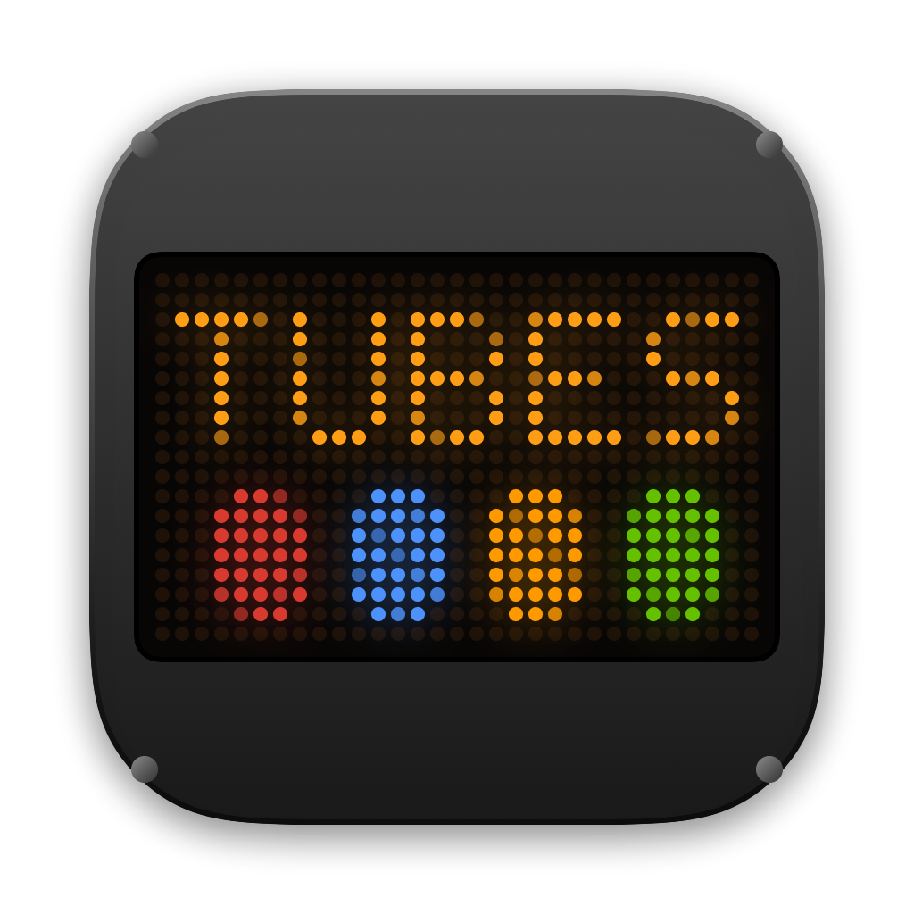
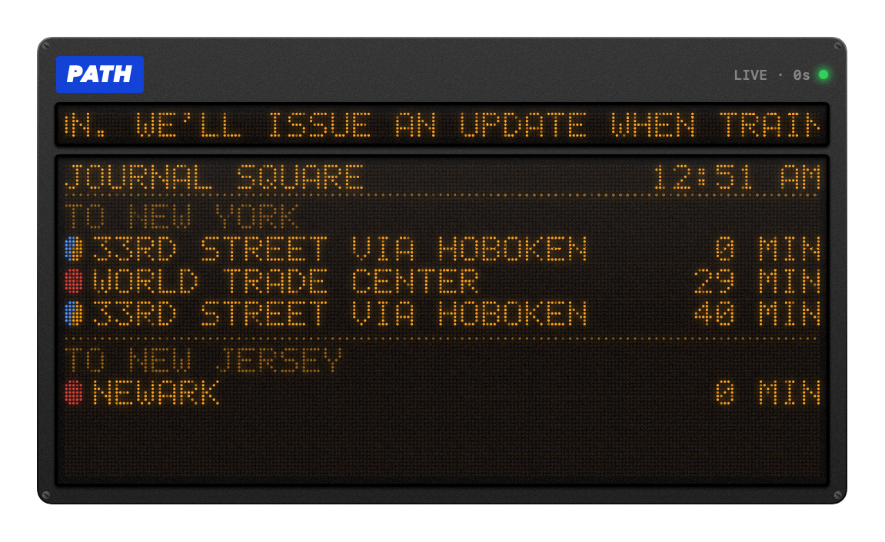

<p align="center">
  
</p>

<h1 align="center">Tubes — PATH Train Departure Board for macOS</h1>

<p align="center">
  <b>Live PATH train departures on your Mac — rendered like the amber LED sign on the platform.</b>
</p>

<p align="center">
  
  
  
  
  <a href="../../actions/workflows/build.yml"></a>
  <a href="LICENSE"></a>
</p>

<p align="center">
  
</p>

<p align="center">
  
</p>

---

The name comes from the **Hudson Tubes**, PATH's original name when it opened in 1908.

## Features

- **Same data as the platform sign.** Tubes reads the Port Authority's real-time TrainDisplay feed that also powers the RidePATH app. Arrival times are shown exactly as the feed reports them, never recalculated, and refresh every 8 seconds.
- **Scrolling service alerts.** Open PATHAlerts scroll across the top strip, just like station announcements.
- **A real dot-matrix display.** Text is drawn on a 5×7 LED font, LED by LED. It includes dim unlit diodes, uneven brightness, bloom, glass sheen and grain inside a metal casing with screws.
- **Line colors.** Each train gets a colored marker for its line, and two-line services like *Journal Square–33rd St via Hoboken* get a split marker.
- **Menu bar at a glance.** Station code, next train each way with line color, and the train after that. Readable on both light and dark menu bars.
- **Stays put.** The board is a frameless, draggable window that can float above other windows and on every Space. Its size stays fixed when you switch stations.
- **All 13 stations**, from Newark to 33rd Street.
- **Tiny.** A single SwiftUI app with no dependencies, no account and no tracking.

## Install

1. Download `Tubes.zip` from the [latest release](../../releases/latest) and unzip it.
2. Move **Tubes.app** to `/Applications`.
3. The app is open source and not notarized, so macOS will block it on first launch. Either right-click it and choose **Open**, or run:

   ```bash
   xattr -dr com.apple.quarantine /Applications/Tubes.app
   ```

Pick your station from the menu bar item or by right-clicking the board.

## Build from source

You only need the Xcode command line tools (`xcode-select --install`). No Xcode project is required.

```bash
git clone https://github.com/therealjjz/path-train-board-macos.git
cd path-train-board-macos
./build.sh          # → build/Tubes.app (universal)
open build/Tubes.app
```

`./build.sh --zip` also packs `build/Tubes.zip` for a release. `scripts/render-assets.sh` regenerates the screenshots and app icon from live data.

## How it works

| Piece | Where |
| --- | --- |
| Feed models and fetching, alert de-duplication, stations (Foundation only) | [`Sources/TubesFeed`](Sources/TubesFeed) |
| 5×7 LED font, LED renderer, board layout, polling store | [`Sources/TubesUI`](Sources/TubesUI) |
| Mac app: floating window, menu bar, settings | [`Sources/TubesMac`](Sources/TubesMac) |

**Data sources** (both public endpoints used by panynj.gov):

- `https://www.panynj.gov/bin/portauthority/ridepath.json` — real-time departures per station
- `https://www.panynj.gov/bin/portauthority/alerts?agency=PATH&hours=8` — PATHAlert service alerts

Each frame of the board is composed into a small grid of palette indices. Every LED is then drawn as a dot: unlit ones as a faint amber-brown, lit ones in three slightly different brightness levels, with a blurred bloom layer underneath. The alert strip is redrawn at 30 fps and steps one LED column at a time, the way real signs do.

## Disclaimer

Tubes is an independent hobby project. It is **not affiliated with, endorsed by, or connected to** the Port Authority of New York and New Jersey or PATH. "PATH" is a trademark of the Port Authority. Times come straight from the public feed. Always check official sources when it matters.

## License

[MIT](LICENSE)
